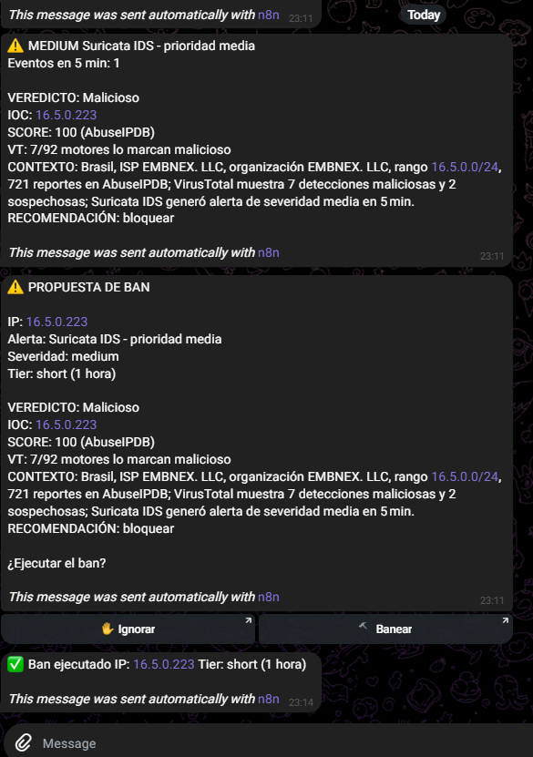
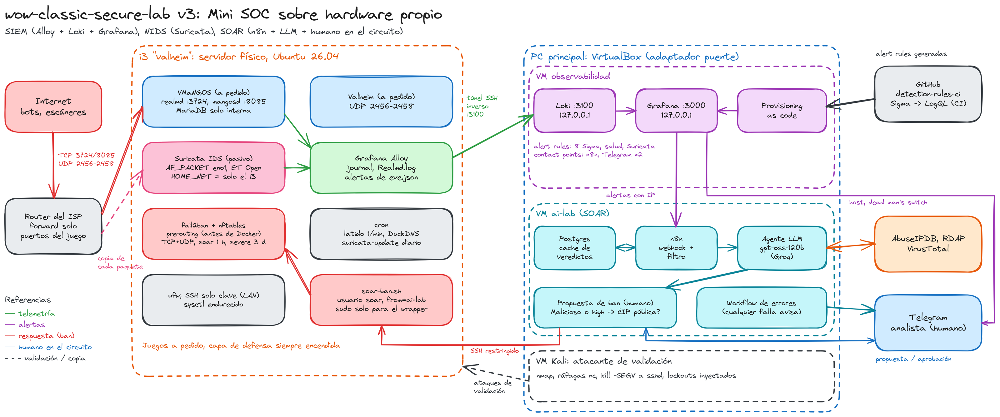
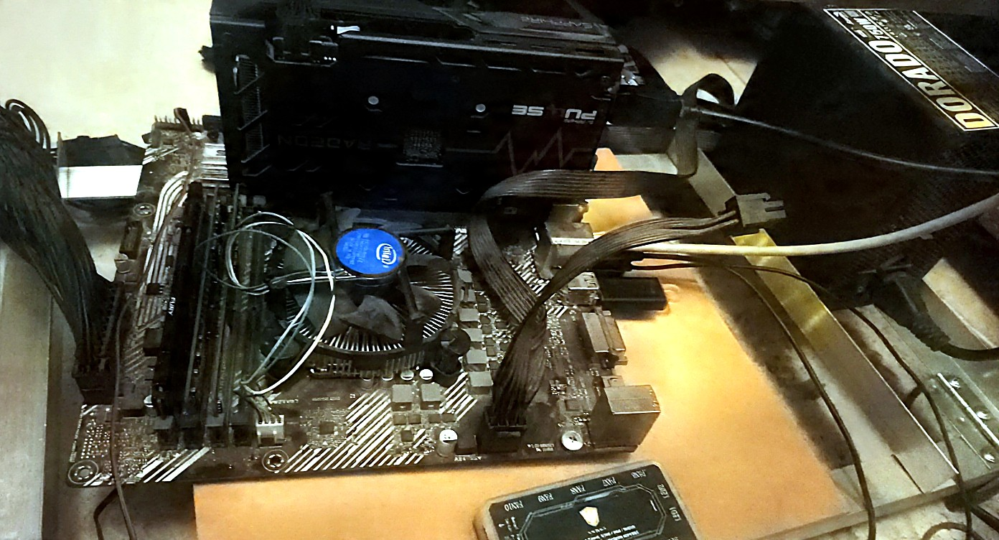
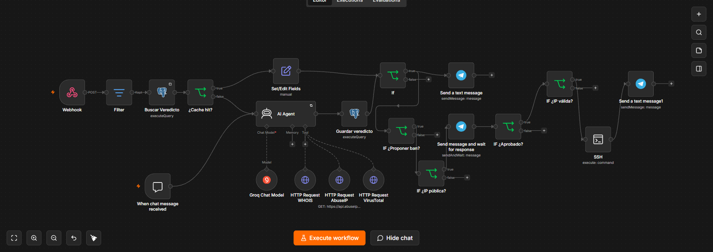
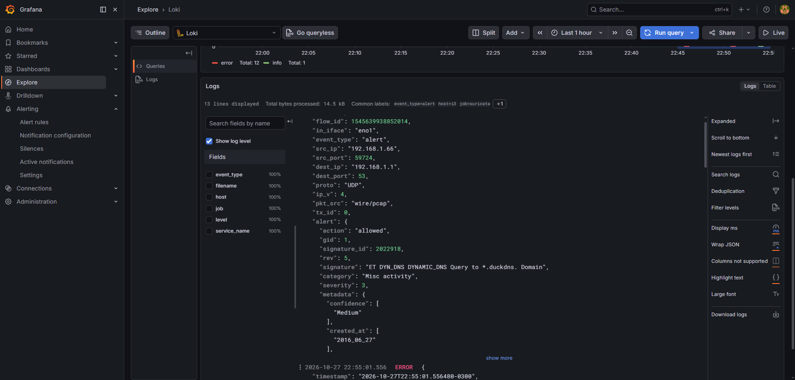

# Secure Game Server Lab: un Mini SOC sobre hardware propio

[English](README.md) | **Español**

Este proyecto es un SOC chico (SIEM, IDS de red y SOAR) que armé en casa para
proteger un servidor de juego expuesto de verdad a internet: WoW Classic 1.12.1
(VMaNGOS) y Valheim, corriendo en una máquina física propia. El juego es solo
la carga de trabajo. De lo que se trata el proyecto es de ingeniería de
detección, de respuesta automatizada en la que yo apruebo cada acción, y de
probar cada control contra ataques reales antes de confiar en él.

Las versiones 1 y 2 corrían en AWS EC2. En octubre de 2026 pasé todo a
hardware propio (los motivos están en [ADR-001](docs/adr/ADR-001-aws-to-home-lab.md)).

---

## En resumen

A la media hora de prender Suricata, un escáner que figura en varias listas
negras golpeó el puerto del servidor de mundo. Suricata lo reconoció por
reputación, el SOAR lo consultó (AbuseIPDB 100, VirusTotal 7/92), el analista
LLM lo clasificó como Malicioso, y el ban se ejecutó recién cuando lo aprobé
en Telegram. El informe completo está en
[INC-2026-001](docs/ir/informes/INC-2026-001-escaneo-reputacion-8085.md).

| | |
|---|---|
| **Detección** | 8 reglas Sigma (CI y `pytest` con líneas de log reales), Suricata con unas 53 mil firmas de ET Open |
| **Cobertura ATT&CK** (v19) | 7 técnicas en 5 tácticas, medido con [`attack-mapper`](https://pypi.org/project/attack-mapper/) |
| **Respuesta** | Análisis con LLM, Telegram, mi aprobación, un usuario SSH restringido y después `fail2ban` (todos los puertos, TCP y UDP, Docker incluido) |
| **Salud del SOC** | Un latido con dead man's switch, más un workflow de errores, para que el SOC me avise cuando deja de ver |
| **Evidencia** | Cada control se atacó a propósito, ver [Validación](#validación-cada-control-atacado) |
| **Respuesta a incidentes** | Playbooks basados en NIST SP 800-61 Rev. 3 y dos informes de incidentes reales |

---

## Arquitectura (v3)

El diagrama original está en [`docs/architecture-v3.excalidraw`](docs/architecture-v3.excalidraw) y se puede abrir en excalidraw.com.

*El servidor i3: un ex equipo de minería que ahora corre los juegos y la capa de defensa.*

| Dónde | Qué | Notas |
|---|---|---|
| **i3** (i3-10100F, 16 GB) | VMaNGOS, Valheim, Suricata, Alloy, fail2ban | Los juegos arrancan cuando los necesito; las defensas arrancan con la máquina |
| **VM `observabilidad`** | Loki 3.0 y Grafana 13 | Creada con un script (instalación desatendida de Ubuntu), los dos escuchan solo en `127.0.0.1` |
| **VM `ai-lab`** | n8n 2.28 y Postgres 16 | El SOAR. LLM: `openai/gpt-oss-120b` en Groq |
| **VM Kali** | Atacante | Todos los controles de este repo se atacaron desde acá |

---

## Mapa del repositorio

| Carpeta | Contenido |
|---|---|
| [`infra/`](infra/) | VMs como código: `deploy-vm.sh` y una instalación desatendida de Ubuntu, con placeholders en lugar de secretos |
| [`vmangos/`](vmangos/) | Compose del servidor de juego (imágenes fijadas por digest, secretos en `.env`, realmlist con split horizon) |
| [`i3/`](i3/) | Configuración del host: SSH, `fail2ban`, `sysctl`, Suricata, el wrapper de bans del SOAR con su `sudoers`, tareas de cron (latido, DDNS, firmas) |
| [`alloy/`](alloy/) | Agente de logs para el journal, el log del juego y las alertas de Suricata, con un contrato de labels documentado |
| [`grafana/`](grafana/) | Loki y Grafana, todo provisionado: datasource, contact points, alert rules y dashboards |
| [`soar/`](soar/) | Compose de n8n y Postgres, el workflow exportado (sin secretos) y el esquema del cache |
| [`docs/ir/`](docs/ir/) | Playbooks de respuesta a incidentes, plantilla de informe e informes reales |
| [`docs/adr/`](docs/adr/) | Registros de decisiones de arquitectura |
| [`docs/threat-model.md`](docs/threat-model.md) | Modelo de amenazas de la instalación en casa y los riesgos que acepté |
| [`docs/legacy-aws/`](docs/legacy-aws/) | Documentos y configuraciones de la v1 y la v2 (AWS EC2), guardados como historia |

Las reglas de detección tienen su propio repo: [`detection-rules-ci`](https://github.com/JoseArgento/detection-rules-ci).

---

## Cómo funcionan la detección y la respuesta

1. **Telemetría.** Grafana Alloy (Promtail llegó a fin de vida) envía el
   journal de systemd, el `Realmd.log` del juego con la hora de cada evento, y
   las alertas de Suricata. Los logs salen del host por un túnel SSH inverso,
   y la clave que usa solo puede abrir `127.0.0.1:3100`. No se abre ningún
   puerto entrante en ningún lado.
2. **Detección como código.** Las reglas Sigma se compilan a LogQL en CI, se
   prueban contra líneas de log reales de este host y se convierten en alert
   rules de Grafana con UIDs fijos. El repo de reglas es la única fuente de
   verdad.
3. **Detección de red.** Suricata funciona como IDS pasivo con ET Open. Su
   `HOME_NET` es solo el servidor y no toda la LAN, así que un atacante dentro
   de mi propia red también dispara firmas. A Loki solo llegan las alertas.
   Las de prioridad 1 y 2 van al SOAR; las de prioridad 3 quedan para consultar
   pero no avisan.
4. **Análisis en el SOAR.** n8n consulta la IP en AbuseIPDB, RDAP y
   VirusTotal, y un LLM da un veredicto siguiendo reglas escritas (por ejemplo,
   una reputación limpia nunca baja el veredicto si el comportamiento que veo
   es hostil). Los veredictos quedan en un cache en Postgres para no analizar
   dos veces la misma IP.
5. **Cada ban lo apruebo yo.** El LLM recomienda y yo decido. Un ban solo se
   propone si el veredicto es Malicioso o si la regla es de severidad alta, y
   nunca para IPs privadas. La IP se revisa tres veces: antes de proponer,
   después de que apruebo, y otra vez en el servidor con `soar-ban.sh`.
6. **Controlar que el SOC funcione.** Un latido por minuto alimenta un dead
   man's switch, y cualquier ejecución fallida del SOAR me manda un mensaje por
   Telegram. Que esté todo en silencio no lo doy por bueno.

Más detalle en [`docs/soar-pipeline.es.md`](docs/soar-pipeline.es.md).

---

## Hardening en casa

| Control | Cómo | Cómo lo verifiqué |
|---|---|---|
| **Poca exposición** | El router solo reenvía los puertos del juego. SSH nunca se expone y UPnP está apagado | Chequeo de puertos desde afuera: 3724 y 8085 abiertos; 22, 80, 443 y 8080 cerrados |
| **SSH** | Solo con clave, sin root, accesible solo desde la LAN con `ufw` | `sshd -T`, y un login con contraseña es rechazado |
| **Bans que también cubren Docker** | `fail2ban` bloquea en la cadena `prerouting` de nftables (prioridad -150, antes del DNAT de Docker), para TCP y UDP | Desde la Kali: abierto, después timeout durante el ban, y abierto de nuevo al levantarlo |
| **Mínimo privilegio para la automatización** | La clave del usuario `soar` solo funciona desde la VM del SOAR, no tiene shell, y `sudo` solo le permite un wrapper que valida lo que recibe | 21 casos de prueba del wrapper, más un intento de escalada |
| **Kernel** | `sysctl`: sin redirects ni source routing, paquetes martians registrados, punteros del kernel ocultos, ptrace y eBPF solo para root. Una excepción documentada: `ip_forward=1`, que Docker necesita | Diff antes y después, y se mantiene después de reiniciar |
| **Cadena de suministro** | Cada imagen se fija por digest una vez que la verifiqué | Así se detectó un cambio incompatible del upstream durante la migración |
| **Secretos** | Solo en archivos `.env` que git ignora, con plantillas `.env.example`. Los workflows se exportan y se revisan antes del commit | La revisión encontró una clave de API escrita directo en un nodo |
| **Juegos a pedido** | VMaNGOS y Valheim no arrancan con el sistema; `restart: on-failure` solo recupera caídas | Prueba de reinicio |

---

## Validación: cada control atacado

| Control | Prueba | Resultado |
|---|---|---|
| Los bans alcanzan los puertos que publica Docker | `nc` desde la Kali al 3724 y al 22, ban, reintento, unban | abierto, timeout, abierto |
| SOAR de punta a punta | Un lockout inyectado desde una IP TEST-NET, y después la aprobación | Loki, alerta, n8n, Telegram, ban, registro de auditoría |
| Sin bans para IPs internas | Un lockout inyectado desde una IP de la LAN | Llega el veredicto sin botón de ban |
| Dead man's switch | Agente de logs detenido unos 5 minutos | Alerta por Telegram y después el aviso de recuperación |
| Reinicio | `sudo reboot` | Los juegos quedan apagados, las defensas arrancan, el túnel se reconecta, 1 minuto sin latido |
| Suricata contra un atacante interno | Una ráfaga de conexiones SSH desde la Kali | *ET SCAN Potential SSH Scan*, y un veredicto que nombra la firma |
| Detección después de recargar reglas | Recarga y nuevo escaneo | Alerta posterior a la recarga (acá encontré y arreglé un bug, ver las lecciones) |
| **Atacante real** | Un escáner de internet que está en listas negras | Detectado, analizado y baneado con mi aprobación ([INC-2026-001](docs/ir/informes/INC-2026-001-escaneo-reputacion-8085.md)) |

---

## Respuesta a incidentes

Los playbooks siguen **NIST SP 800-61 Rev. 3** (abril de 2025, perfil de CSF 2.0):

- [IR-01: IP externa hostil](docs/ir/IR-01-ip-externa-hostil.md)
- [IR-02: Actividad hostil desde la LAN](docs/ir/IR-02-actividad-hostil-lan.md)
- [IR-03: El SOC dejó de ver](docs/ir/IR-03-soc-ciego.md)

Incidentes reales, escritos con la [plantilla de informe](docs/ir/plantilla-informe.md):

- [INC-2026-001](docs/ir/informes/INC-2026-001-escaneo-reputacion-8085.md): un escáner en listas negras golpeó el puerto del mundo. Se detectó, se analizó y se baneó.
- [INC-2026-002](docs/ir/informes/INC-2026-002-periodo-ciego-soc.md): siete horas con el SOC apagado. Qué se perdió, qué guardó el host y por qué una mala reputación no siempre significa un ataque.

---

## Lecciones aprendidas

- **En una sola noche encontré tres formas de que el SOC se quede callado.**
  Una recarga de reglas de Suricata reseteó `HOME_NET` sin dar ningún error y
  dejó de ver al atacante interno. El LLM calificó como benigno un escaneo real
  porque nunca recibió el nombre de la firma. Y una llamada al LLM que chocó
  con el límite de uso cortó la ejecución sin avisarle a nadie. Las tres están
  arregladas y probadas, y lo que me llevo es que el monitoreo también necesita
  ser monitoreado.
- **El LLM recomienda y el workflow decide.** El mismo evento con menos
  contexto recibió otro veredicto. Por eso un ban depende del veredicto, de la
  severidad de la regla y de un control fijo sobre la IP, y ninguno de los tres
  puede banear (ni ocultar una alerta) por su cuenta.
- **Una mala reputación no siempre significa un ataque.** Un escáner de
  medición de internet tiene 100 % en AbuseIPDB solo porque mucha gente lo
  reporta, y su registro WHOIS dice que no está atacando a nadie. Cuando
  recorté la respuesta de las herramientas para ahorrar tokens, había sacado
  justo esa línea.
- **Los bans y Docker van por caminos distintos.** `fail2ban` bloquea en
  `input`, pero el tráfico hacia los contenedores publicados pasa por DNAT y
  `forward`. Mover los bans a `prerouting`, y probarlo con un ataque real,
  cerró ese hueco.
- **Un componente "más seguro" puede romper la detección.** Después de pasar
  a `sudo-rs`, los intentos de escalada rechazados dejaron de aparecer en los
  logs. Me di cuenta solo porque generé el evento real.
- **Si no está en Git no existe, y si no está en un volumen tampoco.** El
  único historial de tráfico hostil real estaba en la capa de escritura de un
  contenedor, hasta que la migración lo dejó en evidencia.
- **Fijar lo que ya se verificó.** Una imagen con un cambio incompatible llegó
  por `latest`. Ahora las imágenes se fijan por digest después de verificarlas.
- **Es QA aplicado a la seguridad.** Si un control aparece en este README, hay
  una prueba que intentó romperlo.

---

## Análisis del cliente no confiable (v1)

El cliente del juego vino de una fuente no oficial, así que hasheé y analicé
cada binario (VirusTotal más análisis dinámico) antes de ejecutarlo o
compartirlo. Una DLL empaquetada con UPX tuvo 2 detecciones heurísticas sobre
70 y resultó ser un falso positivo. Informe completo:
[`evidence/binary-verification.es.md`](evidence/binary-verification.es.md).

---

## Historia

| Versión | Dónde | Cambios principales |
|---|---|---|
| v1 | AWS EC2 | Despliegue multinivel endurecido, análisis de malware del cliente |
| v2 | AWS EC2 y VMs | SIEM (Promtail, Loki, Grafana), Sigma en CI, SOAR en n8n con LLM y aprobación por Telegram |
| **v3** | **Hardware propio** | Migración ([ADR-001](docs/adr/ADR-001-aws-to-home-lab.md)), Alloy, Suricata, bans que cubren Docker, controles de salud del SOC, playbooks de IR |

Los documentos de la v1 y la v2 están en [`docs/legacy-aws/`](docs/legacy-aws/).

---

## Sobre mí

Soy **José**, QA Automation Engineer en transición a blue team e ingeniería de
detección. Este lab es la base de mi trabajo final de la Diplomatura en
Ciberseguridad (UTN).

Trato de llevar a la seguridad los hábitos de un tester: entender qué está
expuesto antes de exponerlo, atacar cada control antes de confiar en él, y
guardar la evidencia.

[LinkedIn](https://www.linkedin.com/in/jos%C3%A9-angel-argento-victoria/) | [detection-rules-ci](https://github.com/JoseArgento/detection-rules-ci) | [pentest-lab](https://github.com/JoseArgento/pentest-lab)

---

## Aviso

Lab personal y sin fines comerciales, sobre infraestructura propia, para
aprender ingeniería de detección, respuesta a incidentes y seguridad en Linux.
Todos los ataques de validación apuntan a mis propios sistemas.

## Licencia

MIT, ver [`LICENSE`](LICENSE).
