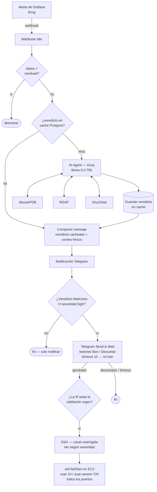

# 🤖 Pipeline SOAR — Triage con LLM y Respuesta con Humano en el Loop

[English](soar-pipeline.md) | **Español**

> Extensión de respuesta del laboratorio blue team: cada alerta disparada por el
> SIEM se enriquece automáticamente, es triageada por un analista LLM, cacheada y
> entregada a Telegram — y las IPs confirmadas como hostiles pueden banearse en
> **todos** los vectores de ataque con un solo toque, a través de un canal de
> ejecución deliberadamente restringido.

---

## 🎯 Objetivo

Cerrar el ciclo de *detección* a *respuesta* sin sacar el criterio humano de la
decisión que importa. La automatización se encarga del trabajo repetitivo de
analista (consultas de reputación, recolección de contexto, deduplicación); un
humano aprueba o descarta cada ban. La meta de diseño fue que el camino seguro
sea el camino por defecto en cada etapa.

---

## 🧩 Arquitectura

El pipeline corre sobre n8n (self-hosted, VM Ubuntu) y recibe las alertas desde
el contact point webhook de Grafana:

| Etapa | Componente | Responsabilidad |
|---|---|---|
| Ingesta | Webhook n8n + Filter | Recibir alertas, descartar payloads `resolved` |
| Memoria | Cache de veredictos en PostgreSQL | Un análisis por IOC, no por alerta |
| Triage | Agente LLM + 3 herramientas de enriquecimiento | Reputación, propiedad, veredicto conductual |
| Notificación | Telegram | Veredicto + conteo fresco de eventos, siempre |
| Respuesta | Send & Wait → SSH → fail2ban | Ban aprobado por humano, agnóstico del vector |

---

## 🗃️ El cache de veredictos — y por qué importa separar los scopes

Los atacantes repiten. La misma IP que intentó fuerza bruta por SSH a las 03:00
aparece contra el protocolo del juego a las 03:20. Volver a correr tres consultas
de API y un análisis LLM para un IOC que fue completamente caracterizado hace
veinte minutos desperdicia cuota y agrega latencia, así que los veredictos se
cachean en Postgres (patrón cache-aside: consultar antes de analizar, escribir
después).

La regla de diseño sutil que emergió:

> **Los datos con scope de IOC van al cache. Los datos con scope de alerta deben
> renderizarse frescos en cada notificación.**

La reputación de una IP, su propiedad (RDAP) y su veredicto conductual describen
al *IOC* — son estables y cacheables. El nombre de la alerta y la cantidad de
eventos en la ventana actual describen a *esta alerta* — renderizarlos desde el
cache produce mensajes viejos y engañosos ("3 eventos" para siempre, sin importar
lo que esté pasando de verdad). Por eso cada mensaje de Telegram se ensambla
desde dos fuentes: cuerpo del veredicto cacheado + encabezado fresco de la
alerta tomado directamente del payload del webhook.

---

## 🧠 Triage con LLM — enriquecimiento con regla de triangulación

Un cache miss enruta el IOC a un nodo AI Agent (Groq, `llama-3.3-70b-versatile`)
con tres herramientas a disposición:

| Herramienta | Pregunta que responde |
|---|---|
| **AbuseIPDB** | ¿La comunidad reportó esta IP? Score de confianza, categorías |
| **RDAP** | ¿Quién es dueño de este rango? ¿Hosting, ISP residencial, cloud? |
| **VirusTotal** | ¿Los vendors la marcan? Con matiz de interpretación — un conteo bajo de detecciones sobre una IP es evidencia débil en cualquier dirección |

El system prompt codifica criterio de analista, no solo formato:

- **Contexto de scoring conductual** — el agente sabe qué *significa* cada alerta
  operativamente (ej.: un evento de lockout de VMaNGOS representa **11 intentos
  fallidos confirmados** comprimidos en una sola línea de log, y jamás puede
  clasificarse como benigno por conteo de eventos).
- **La regla de triangulación** — *una reputación limpia jamás puede anular
  comportamiento hostil observado*. Los servicios de reputación tienen huecos de
  cobertura; los paquetes que golpean este servidor son la verdad de campo. Un
  score impecable en AbuseIPDB no neutraliza un patrón de fuerza bruta observado
  — solo significa que somos los primeros en reportarlo.

Veredictos posibles: **Malicioso / Sospechoso / Benigno**, cada uno con una
justificación corta que viaja con la notificación.

---

## 🚫 Respuesta con humano en el loop

El baneo totalmente automatizado se descartó a propósito: un falso positivo que
banea a un jugador legítimo (o al admin) es peor que una respuesta demorada en
el contexto de un lab. En cambio, el pipeline **propone** y un humano **dispone**:

1. **Matriz de propuesta (nodo IF)** — se propone un ban si el veredicto del LLM
   es *Malicioso* **o** si la severidad de la alerta es *high*. La severidad high
   siempre propone, sin importar la opinión del LLM: la severidad de las reglas
   de detección es determinística y pasa por code review; el LLM no tiene poder
   de veto sobre ella. La severidad se lee de `annotations.severity` (definida
   por la regla), no de los labels.
2. **Telegram Send & Wait** — el analista recibe botones de Ban / Descartar.
   Ante timeout (1 hora) el default es **no banear**: la ausencia de un humano
   nunca escala a una acción irreversible.
3. **Validación de input** — la IP objetivo debe pasar una validación regex
   estricta en n8n *antes* de llegar al nodo SSH. Los campos del payload de la
   alerta se tratan como input no confiable; es el equivalente SOAR de las
   queries parametrizadas.
4. **Ejecución por tiers** — el nodo SSH banea hacia una jail elegida según
   severidad: `soar` (1 h) para confirmaciones estándar, `soar-severe` (72 h)
   para alertas de severidad alta.

---

## 🔐 Decisiones de seguridad en el diseño

El canal de respuesta es el componente más peligroso del lab — es, por
definición, ejecución remota de comandos contra el host productivo. Se construyó
en consecuencia:

1. **Un script wrapper es lo único que puede ejecutarse.** El canal SSH ejecuta
   `soar-ban.sh`, que re-valida el formato de la IP del lado servidor, **rechaza
   rangos privados** (un pipeline comprometido no puede banear la LAN ni el
   túnel), y registra cada invocación en journald como pista de auditoría.
2. **Usuario `soar` dedicado, `sudoers` restringido.** El usuario de automatización
   puede correr exactamente un comando como root: el wrapper. No fail2ban-client
   directo, no una shell — un script, con los argumentos validados adentro.
3. **Clave ed25519 con restricciones en `authorized_keys`.** La clave que usa n8n
   está bloqueada en `authorized_keys` (restricciones estilo forced command /
   no-pty), así que incluso el robo de la clave rinde el wrapper y nada más.
4. **Bans agnósticos del vector vía jails dedicadas.** Las jails `soar` usan
   `banaction_allports` (nftables): un ban disparado por una alerta SSH también
   cierra los puertos del juego (3724/8085) y viceversa. Un mecanismo, todos los
   vectores — sin duplicación por servicio.
5. **Red de seguridad con `ignoreip`.** La IP de casa está exenta a nivel de
   fail2ban: ni siquiera un error completamente aprobado puede dejar al operador
   afuera.
6. **Defaults conservadores en todos lados.** Las alertas resueltas se descartan,
   los timeouts significan no-ban, y las fallas de validación terminan en
   silencio en vez de ejecutar "a la que va".

---

## 🧪 Lecciones del tuning

- **La semántica de la severidad tiene que vivir en el prompt, no en la cabeza
  del analista.** El agente inicialmente clasificó una alerta de IP-lockout como
  *Benigno* porque vio "1 evento" — técnicamente cierto, semánticamente erróneo
  (ese único evento codifica 11 intentos fallidos). El fix fue codificar el
  significado de cada alerta en el system prompt, y quitarle al LLM el veto
  sobre las alertas de severidad alta por completo.
- **Los veredictos cacheados sobreviven a las mejoras del prompt.** Tras mejorar
  el system prompt, los veredictos viejos generados bajo el prompt anterior
  seguían sirviéndose desde Postgres. Ahora los cambios de prompt implican
  invalidar el cache — la misma disciplina que romper un cache de build después
  de cambiar el compilador.
- **El linaje de items de n8n se rompe en los nodos AI Agent.** Los nodos aguas
  abajo del agente deben referenciar el payload original explícitamente
  (`$('Webhook').first()`) en vez de confiar en el flujo de items de `$json` —
  de lo contrario leen items vacíos en silencio.

---

## 🧠 Habilidades demostradas

- Diseño de pipeline SOAR (ingesta → enriquecimiento → triage → respuesta) sobre n8n
- Integración de LLM para triage de seguridad con uso de herramientas y criterio
  de analista codificado
- Diseño de cache (cache-aside) con un principio claro de scoping de datos
- Respuesta con humano en el loop y defaults conservadores a prueba de fallas
- Canal de ejecución remota endurecido: validación de input, mínimo privilegio,
  sudoers restringido, claves SSH con forced command, logging de auditoría
- Prompt engineering guiado por incidentes y sus consecuencias operativas
  (invalidación de cache)

---

*Parte del laboratorio de ciberseguridad — extensión de triage y respuesta
automatizada. Las detecciones que alimentan este pipeline:
[`detection-rules-ci`](https://github.com/JoseArgento/detection-rules-ci).*
