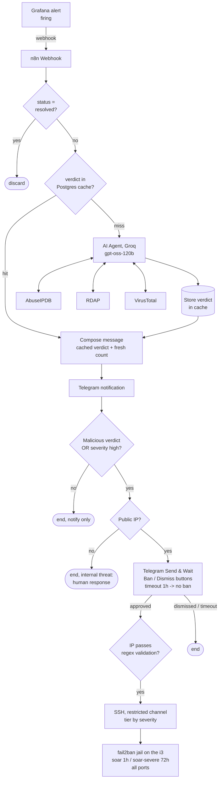

# SOAR Pipeline: LLM Triage & Human-in-the-Loop Response

**English** | [Español](soar-pipeline.es.md)

> Response extension of the blue-team lab: every alert fired by the SIEM is
> automatically enriched, triaged by an LLM analyst, cached, and delivered to
> Telegram, and confirmed-hostile IPs can be banned across **all** attack
> vectors with a single tap, through a deliberately restricted execution channel.

> **v3 (October 2026):** the pipeline now runs against the home lab (the i3
> server) instead of AWS. Changes since v2: model `openai/gpt-oss-120b`;
> Suricata alerts as a new input; a **public-IP check before proposing** a ban;
> the alert's signature/summary passed to the agent; tool responses trimmed to
> save tokens; an **error workflow** that reports any failed run to Telegram;
> and the workflow itself versioned in [`soar/`](../soar/).

---

## Objective

Close the loop from *detection* to *response* without removing human judgment
from the decision that matters. Automation handles the repetitive analyst work
(reputation lookups, context gathering, deduplication); a human approves or
dismisses every ban. The design goal was to make the safe path the default
path at every stage.

---

## Architecture

The pipeline runs on n8n (self-hosted, Ubuntu VM) and receives alerts from
Grafana's webhook contact point:

| Stage | Component | Responsibility |
|---|---|---|
| Ingestion | n8n Webhook + Filter | Receive alerts, discard `resolved` payloads |
| Memory | PostgreSQL verdict cache | One analysis per IOC, not per alert |
| Triage | LLM agent + 3 enrichment tools | Reputation, ownership, behavioral verdict |
| Notification | Telegram | Verdict + fresh event count, always |
| Response | Send & Wait -> SSH -> fail2ban | Human-approved, vector-agnostic ban |

---

## The verdict cache: and why scope separation matters

Attackers repeat. The same IP that brute-forced SSH at 03:00 shows up against
the game protocol at 03:20. Re-running three API lookups and an LLM analysis
for an IOC that was fully characterized twenty minutes ago wastes quota and
adds latency, so verdicts are cached in Postgres (cache-aside pattern: check
before analyzing, write after).

The subtle design rule that emerged:

> **IOC-scoped data belongs in the cache. Alert-scoped data must be rendered
> fresh on every notification.**

An IP's reputation, ownership (RDAP) and behavioral verdict describe the *IOC*
- they are stable and cacheable. The alert name and the number of events in
the current window describe *this alert*, rendering them from the cache
produces stale, misleading messages ("3 events" forever, no matter what is
actually happening). Every Telegram message is therefore assembled from two
sources: cached verdict body + fresh alert header taken directly from the
webhook payload.

---

## LLM triage: enrichment with a triangulation rule

A cache miss routes the IOC to an AI Agent node (Groq, `openai/gpt-oss-120b`; it replaced `llama-3.3-70b-versatile` when Groq retired that model in August 2026)
with three tools at its disposal:

| Tool | Question it answers |
|---|---|
| **AbuseIPDB** | Has the community reported this IP? Confidence score, categories |
| **RDAP** | Who owns this range? Hosting provider, residential ISP, cloud? |
| **VirusTotal** | Do security vendors flag it? With interpretation nuance, a low detection count on an IP is weak evidence either way |

The system prompt encodes analyst judgment, not just formatting:

- **Behavioral scoring context**, the agent knows what each alert *means*
  operationally (e.g., a VMaNGOS lockout event represents **11 confirmed failed
  attempts** compressed into a single log line, and can never be classified
  as benign on event count alone).
- **The triangulation rule**, *clean reputation can never override observed
  hostile behavior*. Reputation services have coverage gaps; the packets that
  hit this server are ground truth. A pristine AbuseIPDB score does not
  neutralize an observed brute-force pattern, it just means we are the first
  to report it.

Possible verdicts: **Malicious / Suspicious / Benign**, each with a short
justification that travels with the notification.

---

## Human-in-the-loop response

Fully automated banning was rejected deliberately: a false positive that bans
a legitimate player (or the admin) is worse than a delayed response in a lab
context. Instead, the pipeline **proposes** and a human **disposes**:

1. **Proposal matrix (IF node)**, a ban is proposed if the LLM verdict is
   *Malicious* **or** the alert severity is *high*. High severity always
   proposes, regardless of the LLM's opinion: detection-rule severity is
   deterministic and code-reviewed; the LLM does not hold veto power over it.
   Severity is read from `annotations.severity` (rule-defined), not from labels.
2. **Telegram Send & Wait**, the analyst receives Ban / Dismiss buttons.
   On timeout (1 hour) the default is **no ban**: absence of a human never
   escalates into an irreversible action.
3. **Input validation**, the target IP must pass strict regex validation in
   n8n *before* reaching the SSH node. Alert payload fields are treated as
   untrusted input; this is the SOAR equivalent of parameterized queries.
4. **Tiered execution**, the SSH node bans into a jail chosen by severity:
   `soar` (1 h) for standard confirmations, `soar-severe` (72 h) for high-severity
   alerts.

---

## Security decisions in the design

The response channel is the most dangerous component in the lab, it is,
by definition, remote command execution against the production host. It was
built accordingly:

1. **A wrapper script is the only thing that can run.** The SSH channel executes
   `soar-ban.sh`, which re-validates the IP format server-side, **rejects
   private ranges** (a compromised pipeline cannot ban the LAN or the tunnel),
   and logs every invocation to journald for an audit trail.
2. **Dedicated `soar` user, restricted `sudoers`.** The automation user can run
   exactly one command as root: the wrapper. Not fail2ban-client directly, not
   a shell, one script, with arguments validated inside it.
3. **ed25519 key with `authorized_keys` restrictions.** The key n8n uses is
   locked down in `authorized_keys` (forced command / no-pty style restrictions),
   so even key theft yields the wrapper and nothing else.
4. **Vector-agnostic bans via dedicated jails.** The `soar` jails use
   `banaction_allports` (nftables): a ban triggered by an SSH alert also closes
   the game ports (3724/8085) and vice versa. One mechanism, every vector -
   no per-service duplication.
5. **`ignoreip` safety net.** The home IP is exempt at the fail2ban level:
   even a fully approved mistake cannot lock the operator out.
6. **Defaults are conservative everywhere.** Resolved alerts are discarded,
   timeouts mean no-ban, validation failures terminate silently rather than
   "best-effort" executing.

---

## Lessons from tuning

- **Severity semantics must live in the prompt, not in the analyst's head.**
  The agent initially classified an IP-lockout alert as *Benign* because it saw
  "1 event", technically true, semantically wrong (that one event encodes 11
  failed attempts). The fix was encoding the meaning of each alert into the
  system prompt, and removing the LLM's veto over high-severity alerts entirely.
- **Cached verdicts outlive prompt improvements.** After improving the system
  prompt, old verdicts produced under the old prompt were still being served
  from Postgres. Prompt changes now imply cache invalidation, the same
  discipline as busting a build cache after changing the compiler.
- **n8n item lineage breaks at AI Agent nodes.** Nodes downstream of the agent
  must reference the original payload explicitly (`$('Webhook').first()`)
  rather than relying on `$json` item flow, otherwise they silently read
  empty items.

- **Same event, less context, different verdict.** A real SSH scan from the
  LAN came back *Benign*, and the notify-only branch silenced it, because the
  agent saw "Suricata alert, 1 event, private IP" but not the signature name.
  With the signature in the prompt, the same event came back *Suspicious*.
- **A failed run is a silent run.** On the free tier (8K tokens/min) a single
  triage (~7K tokens) can exceed the limit; the run died and nobody was told.
  Now every failure reaches Telegram, and tool outputs are trimmed.
- **Trimming has a cost.** Cutting WHOIS down to a few fields also removed the
  `remarks` where an internet-measurement scanner declares it is not attacking.
  Reputation is not intent: what the agent doesn't see, it can't weigh.

---

## Skills demonstrated

- SOAR pipeline design (ingestion -> enrichment -> triage -> response) on n8n
- LLM integration for security triage with tool use and encoded analyst judgment
- Cache design (cache-aside) with a clear data-scoping principle
- Human-in-the-loop response with conservative, fail-safe defaults
- Hardened remote-execution channel: input validation, least privilege,
  restricted sudoers, forced-command SSH keys, audit logging
- Incident-driven prompt engineering and its operational consequences
  (cache invalidation)

---

*Part of the cybersecurity lab, automated triage and response extension.
Detections that feed this pipeline: [`detection-rules-ci`](https://github.com/JoseArgento/detection-rules-ci).*
